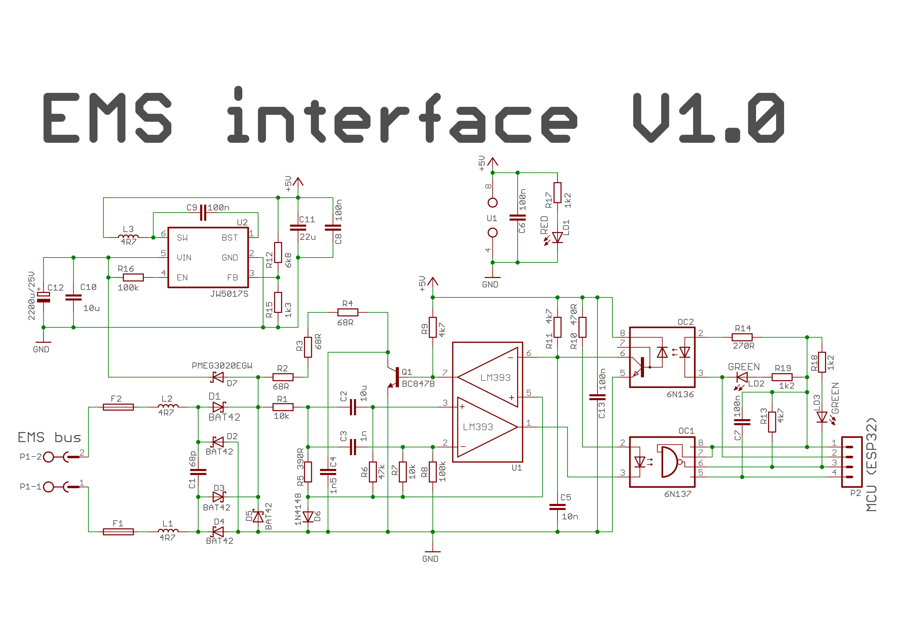
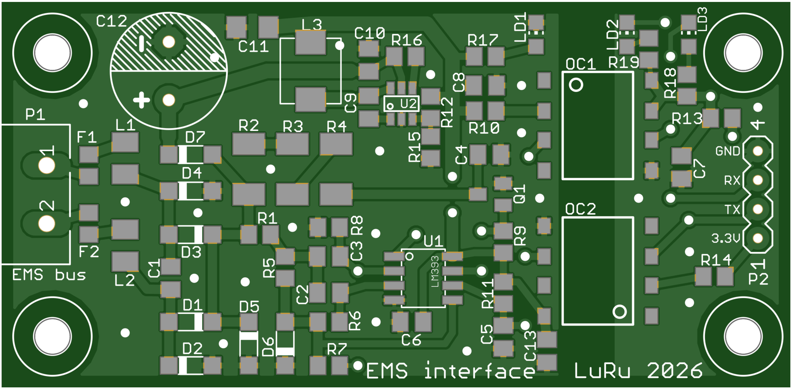
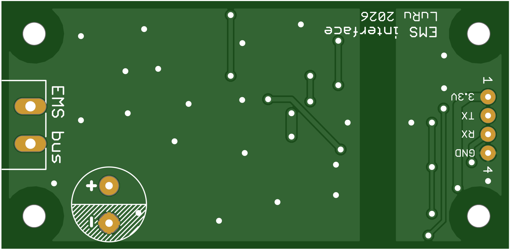
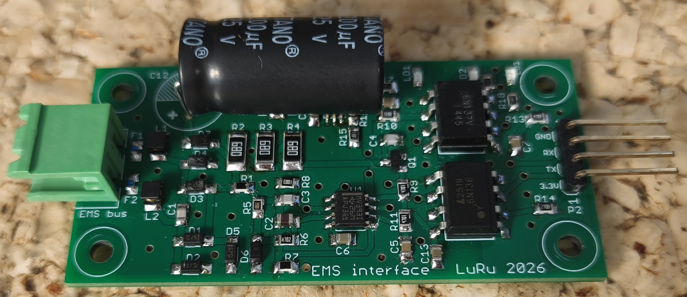
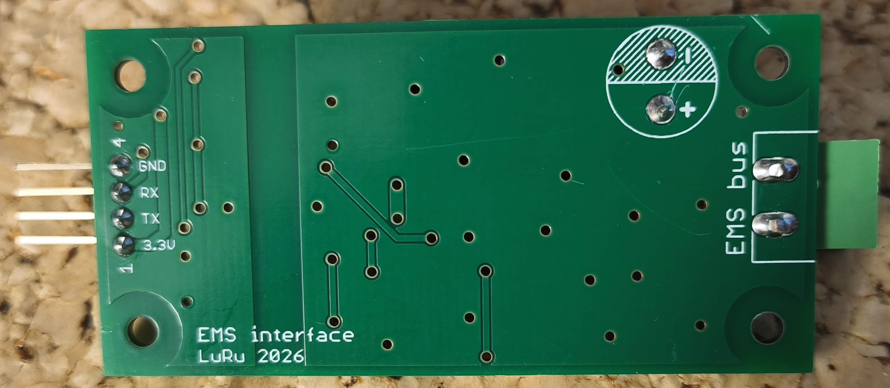
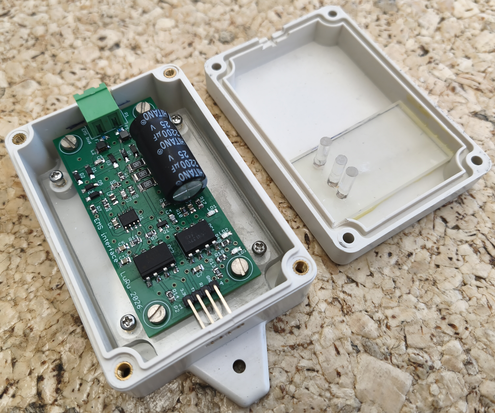
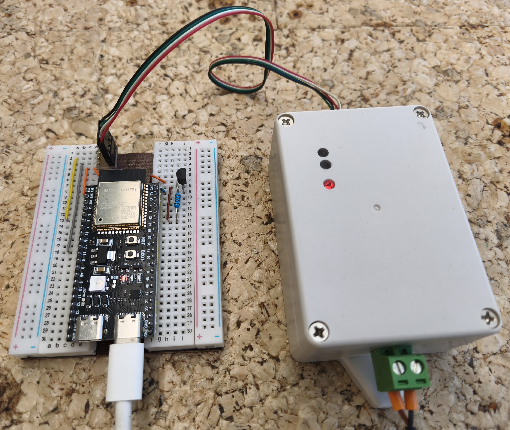
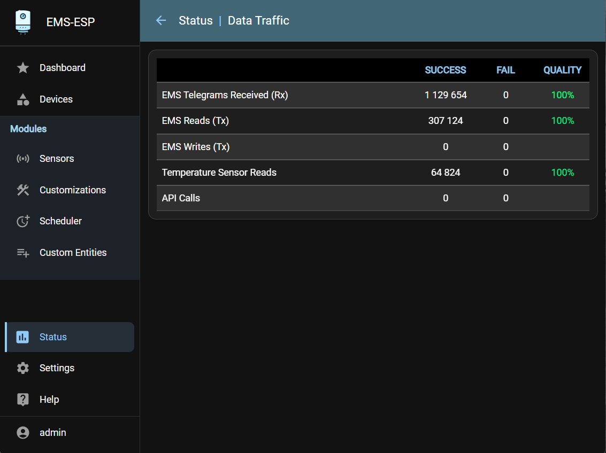

# Optocoupler Isolated EMS Bus Interface for ESP32 / Raspberry Pi

An open-source hardware interface designed to safely connect microcontrollers (like ESP32 or Raspberry Pi) to the **EMS (Energy Management System)** bus used by Bosch, Buderus, Junkers, IVT and Nefit heating systems.

## Key Features

* **Galvanic Isolation:** Full optical/digital isolation protecting your microcontroller and smart home infrastructure from high-voltage spikes or ground loops on the boiler side.
* **4-Pin Output Interface:** Simple connection via `GND`, `Rx`, `Tx`, and `3.3V`.
* **High Compatibility:** Designed to be fully compatible with popular open-source firmware [EMS-ESP32](https://github.com/emsesp/EMS-ESP32).
* **Compact DIY Design:** Two-layer PCB created in Autodesk Eagle, optimized for easy manual soldering or cheap fabrication (JLCPCB, PCBWay).

---

## Technical Specifications

* **Input:** 2-wire EMS Bus (Non-polarized)
* **Output:** 3.3V Logic Levels (`Rx` from EMS to MCU, `Tx` from MCU to EMS)
* **Power Supply:** 
  * EMS Side: Powered directly from the EMS bus line.
  * MCU Side: Powered from the connected microcontroller via the `3.3V` pin (requires approx. 10 mA).
* **Isolation Voltage:** Min 3 kV (achieved via optocouplers 6N137 and 6N136).

---

## Repository Structure

* `/hardware` - Original Autodesk Eagle design files (`.sch`, `.brd` and `.lbr`).
* `/gerber` - Production-ready Gerber and Drill files (Excellon) for easy PCB manufacturing.
* `/bom` - Bill of Materials with component specifications.
* `/assets` - Images and pdf files.

---

## Schematic & PCB Preview
You can notice the strict galvanic isolation of both parts. They are bridged only by optocouplers.

---

## How to Order and Build

1. **Manufacture the PCB:** Download the ZIP file from the `/gerber` folder and upload it to any PCB manufacturer (e.g., JLCPCB, PCBWay, OSH Park). Choose a standard 1.6mm thickness, 2-layer option.
2. **Buy Components:** Refer to the [BOM.csv](./bom/BOM.csv) or [BOM.pdf](./bom/BOM.pdf) file for the exact part list. 
3. **Assembly:** Solder the components starting from the lowest profile parts (resistors, diodes) to the highest (connectors, optocouplers).

---

## Connection Diagram

### EMS Bus Side
Connect the 2-wire terminal to your boiler's EMS service jack or thermostat line.

### Microcontroller Side (e.g., ESP32 running EMS-ESP)

| Interface Pin | ESP32 Pin | Description |
| --- | --- | --- |
| **GND** | GND | Ground reference (isolated side) |
| **Rx** | GPIO 5 (Rx) | Connect to ESP32 Rx pin |
| **Tx** | GPIO 17 (Tx) | Connect to ESP32 Tx pin |
| **3.3V** | 3.3V | Power input for the isolated side |

---

## Software Integration

This hardware is verified to work with:
* **EMS-ESP32 Firmware:** Set the board profile to *Custom* and configure your chosen Rx/Tx pins in the web interface.

---

## Notes on some components

**C12 - 2200µF/25V**  
Originally I wanted to use a capacitor with a capacity of 1000µF. During testing, everything seemed to be fine. However, for dimensional reasons, I also tried a capacitor with a capacity of 470µF, because it fit into the intended box even in the normal position ("vertical"). However, in practice it turned out that with this capacitor the communication error rate increased sharply. Of course, this was not desirable, so I used a larger capacitor (with sufficient margin).

**OC1 and OC2 - 6N137 and 6N136**  
For the Rx direction (EMS -> ESP32), I chose an optocoupler of the 6N137SM-ISO type. It is fast enough and guarantees problem-free communication. In the opposite direction, the cheaper 6N136S-TA1-L is more than enough. Both optocouplers are in an SMD8 package with gull-wing pins.

**R2, R3 and R4 - 68Ω**  
The resistors are in a R2010 type case, so they should last with a large margin. Regular resistors in a R0805 case would be overloaded if used in this way and the connection would not be reliable in the long term.

**U1 - LM393**  
I used the LMV393IDR type.
It is fast enough, suitable for 5V power supply, has low consumption and has open collector outputs.

**U2 - JW5017S**  
You can also use the (perhaps more affordable) RY8310.

---

## Assembled board
Finally, you can see some photos of the fully assembled PCB including the installation in the box and the connection to the ESP32-S3 development kit. I have also added one screenshot showing the statistics of Data Traffic after about 90 hours of operation.

---

## License & Disclaimer

This project is licensed under the Creative Commons Attribution-NonCommercial-ShareAlike 4.0 International License (CC BY-NC-SA 4.0). 

* **Non-Commercial:** The hardware design files were created using the free/personal-use tier of Autodesk Eagle and are strictly intended for non-commercial, educational, and DIY purposes.
* **ShareAlike:** If you remix, transform, or build upon the material, you must distribute your contributions under the same license.

**Disclaimer:** Working with heating appliances carries inherent risks. Improper connection can damage your boiler's mainboard. Use this hardware at your own risk. The author is not responsible for any damage caused by using this design.
